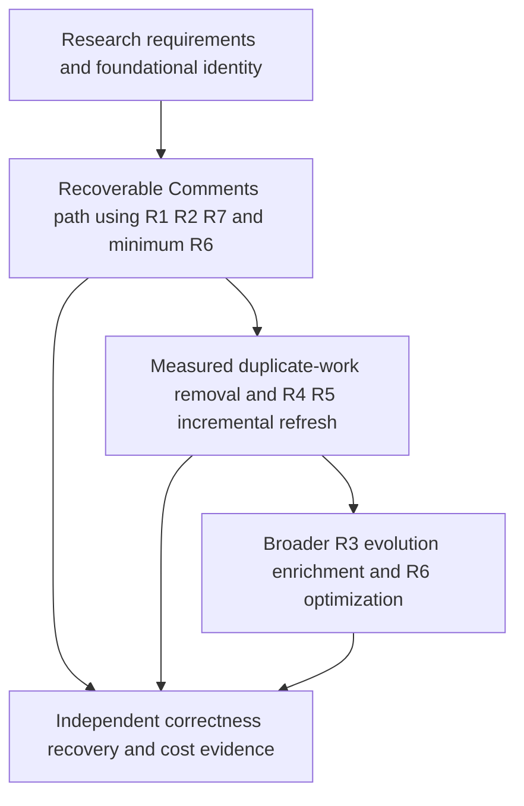

# DocSpec greenfield dataset lifecycle plans

Build a dataset system that accepts source corrections, adds fields, refreshes dependent results, publishes consistent releases, and preserves declared history without routinely rebuilding unchanged data. The first delivery must show that an unchanged or interrupted job reuses every qualified completed phase, preserves exact data and evidence, and explains what work remains.

These plans reflect the accepted architecture review and the user's greenfield direction on October 7, 2026. Existing DocSpec code, APIs, storage choices, identity spellings, and previous implementation decisions are reference material, not constraints. No migration, backward compatibility, or reuse of a particular module is required. Task IDs remain stable planning references. Runtime implementation and capacity qualification remain open.

The [research requirements and acceptance map](RESEARCH.md) applies the October 7 practitioner interviews to these plans. The research prioritizes reuse, recoverable phase boundaries, and operational visibility; it does not prove that replacing the stack will improve performance. Reported successes become acceptance examples without imposing their implementations, and reported historical failures are not asserted to remain current.

## Requirements and user outcomes

| Requirement | Plan | User outcome |
| --- | --- | --- |
| R1 Durable data and commits | [Durability](01-durable-storage.md) | Acknowledged updates and qualified completed phases survive worker loss without repeating expensive work. |
| R2 Incremental publication | [Publication](02-incremental-publication.md) | A small update becomes a complete reproducible release without unnecessary full transfer. |
| R3 Schema evolution and backfill | [Schema evolution](03-schema-backfill.md) | Add or change fields without rebuilding unrelated values or interrupting readers. |
| R4 Verified changes | [Change tracking](04-change-tracking.md) | Find exact changes and affected fields without repeatedly comparing everything. |
| R5 Dependent refresh | [Refresh](05-dependent-refresh.md) | Corrections update the right joins and summaries while ingestion continues. |
| R6 Maintenance and retention | [Maintenance](06-maintenance-retention.md) | Keep reads efficient and storage bounded by explicit history promises. |
| R7 Operations and qualification | [Qualification](07-operations-qualification.md) | See phase progress and resource pressure, know what a retry will repeat, and recover through a supported command. |

## Architectural decisions

| Area | Greenfield decision | Reason |
| --- | --- | --- |
| Authority | One durable transactional catalog owns committed dataset versions, definition selections, result coverage, release intents, and retention roots. | Avoid competing mutable heads and independent lifecycle journals. A maintained catalog/database must supply the required atomicity and durability. |
| Data | Immutable columnar snapshots and retained source objects, with versioned manifests and explicit delete/membership semantics. | Share unchanged objects and support independent pinned readers. Choose maintained storage/query components from measured requirements. |
| Durability | Commit referenced objects first, then atomically commit their verified metadata and selection in the durable catalog. | Acknowledgement follows durable completion. Backup/checkpoint frequency is independent of operation boundaries; bounded group commit is optional and measured. |
| Completed phases | Retain expensive transfer, restoration, processing, and validation outcomes independently of final operation or release completion, using ordinary catalog results. | A later failure must not discard already qualified work. Transfer completion is not validation or publication success. |
| Selected input reuse | Bind one exact input selection and bounded shared read/admission context per operation. | Check qualified completed work before expensive staging. Avoid repeated selection, decoding, and equivalent validation without a second global cache. |
| Identity | Distinguish business keys, source observations, immutable values, schema versions, processing definitions, and dataset versions. | New schema or processing versions must not automatically invalidate unrelated values. Changed values never overwrite earlier occurrences. |
| Reuse dependencies | Record exact source/evidence pins and material processor, schema, policy, and validator dependencies separately from full runtime provenance. | Unrelated package changes do not automatically invalidate all work; relevant changes and receipt-only updates remain visible and correctly invalidate affected checks. |
| Schema | Stable field IDs and explicit evolution rules; track dependencies at justified field or processing-group boundaries. | Rename/addition need not force whole-table identity churn. Arbitrary semantic changes still require evaluation of the affected scope. |
| Enrichments | Independently version fields sharing processing and update behavior; combine through pinned joins or qualified materialization. | Isolate expensive computation without a table or metadata record for every cell. |
| Promotion | Routine refresh selects complete, consistent captured versions with nonregressing coverage. Guard expected output and active definition. | Progress does not require live inputs to stop changing. Strict cutover and explicitly requested latest-input policy additionally compare live heads. |
| Publication | Immutable release roots bind data, schemas, completed coverage, evidence, and disclosure policy. | Readers see an exact version. Determine actual consumers before format freeze; add thin adapters or derived distributions as needed. |
| Retention | One root inventory and removal service; distinct release, recovery, optional change-history, and application history policies. | Expiration cannot override retained inputs, active readers, recovery, or publication obligations. |
| Execution | Parallel bounded workers prepare immutable candidates; catalog transactions serialize conflicting selections. | Global single-writer execution is not a requirement. Choose a maintained executor when scheduling needs justify it. |
| Operations | Report live phase counters, whole-process and engine resource observations, retained completions, and resume actions during execution. | Diagnose progress and repeated work without another data pass. Preflight resource budgets and shared capacity before expensive phases. |
| Optimization | Measure the complete update-to-verified-release path early. | A faster component does not prove that scans, metadata, publication, or read costs are acceptable. |

The shared promotion operation takes the candidate result, expected output, active definition/version guard, complete input coverage, retained source-succession evidence, and explicit promotion policy. The catalog validates the candidate and guards atomically. Routine coverage must stay equal or advance along accepted source history for every required input; timestamps and equal row values do not prove order. A branch, backward vector, or missing ordering evidence requires explicit reconciliation. Strict schema cutover also establishes an exact source boundary and prevents old-definition workers from committing afterward. Applications declare relationships between input versions; there is no implied global transaction across independent publishers.

Durable intents precede external effects. Record release protection before a public pointer changes and removal intent/unavailability before object deletion; record and reconcile outcomes afterward. A backup snapshot is not required at every barrier: the catalog's durable commit and qualified recovery mechanism provide the guarantee. Supported restore points continue to protect their required bytes or must be explicitly retired before reclamation.

Use one implementation for genuinely shared rules: typed encoding, identity admission, completed-result resolution, promotion checks, object-reference verification, and reachability. Keep backfill, refresh discovery, source policy, and reader distributions as focused services. Reuse existing code only when it fits this design; assess maintained components before building infrastructure. Do not create a universal workflow framework or a new SQL engine.

Production readers, validation commands, and resume/status tools use maintained decoders and evidence-member resolution. Persist structured phase and validation outcomes before rendering optional human reports; formatting failure cannot erase verified bytes or completion records. Independent test oracles and required checks at different trust boundaries remain separate.

R1 owns the shared phase-completion and reuse rules. A retained phase binds exact selected data/evidence identities, scope/order, material dependencies, immutable outputs, verification scope and outcome, and resume preconditions. File existence, row counts, a footer, or a prior running marker alone cannot establish completion. R7 explains qualified reuse and required reruns; R6 protects those results through the declared recovery window.

## Delivery order and ownership

Start the native Comments fixture, phase vocabulary, and measurement design in R7 alongside architecture work. Define foundational version/field identity, phase results, reuse dependencies, promotion, and retention semantics first. Capture reader requirements and product targets before format freeze; use bounded probes to choose maintained components. Full schema-evolution delivery is not a prerequisite for the fixed-schema first path.

1. **Recoverable Comments path:** selected input → restoration/processing → subject and receipt/evidence preparation → validation → publication → independent readback. Implement the R1 phase/commit and R2 transfer/publication slices, minimum R6 protection, and R7 status, supported resume, fault injection, and measurement. Qualify unchanged reruns and failures after expensive phases before broad optimization. Use retained fixtures/private qualification; an actual public release remains a separate action.
2. **Remove measured duplicate work and add incremental refresh:** use the first path's read/validation counters and resource evidence to prioritize R4 changes and R5 dependent processing. Compare ordered streaming, selective access, and indexing only for eligible workloads, including cold start and recovery costs.
3. **Expand evolution and maintenance:** deliver broader R3 schema transitions and enrichment composition, additional consumer distributions, and measured R6 compaction/retention optimizations. Preserve the first delivery's recovery and reuse guarantees throughout.

Assign one integrating owner for catalog transactions, phase-result/reuse semantics, identity/schema semantics, release roots, and retention. Task owners identify responsibilities rather than legacy module paths. Deliver the relevant slices of R1-T01–T05, R2-T01–T05, R6-T01/T04–T05, and R7-T01–T06 for the first path; they need not wait for unrelated advanced features. Promotion, empty-state construction, and foundational R3-T01 identity design can land before full backfill or refresh. Every delivered slice still needs its applicable correctness and failure checks.

## Acceptance and unresolved product inputs

Correctness requires exact agreement with independent reconstruction for values, keys, types, null/missing/empty distinctions, multiplicity, applicable ordering, schema meaning, and evidence. Verify no lost accepted updates, no false freshness, no stale-definition promotion, and no deletion of required bytes.

First-delivery acceptance includes failure after qualified receipt transfer, failure after validation during report formatting, a trusted unchanged-input rerun, a receipt-only change, and recovery after public write before readback completion. Completed eligible phases must not repeat; incomplete or invalidated checks must still run. A supported resume command reports reused phases, remaining work, actual consumed identities, and the reason for each rerun. Preserve original values, selected generations, ordered duplicates, receipt history, missing/refused outcomes, and failed attempts.

Hold a small change set fixed while increasing both dataset size and update history. Measure selection/decoding/validation pass counts, cold admission and index construction, processing, scans, metadata commits, recovery, requests/transferred bytes, reader verification, whole-process and engine memory, temporary high-water storage, and total change-to-verified-release time. Include unchanged retries and interrupted/resumed jobs, not only uninterrupted warm-cache runs. Collect live counters during necessary work without another full scan. Keep failed runs and stage-level limitations; proposed speed targets are not measured improvements.

Product inputs remain: actual consumers; acceptable acknowledgement delay and freshness; maximum backfill lag; recovery time and loss tolerance; resource/cost limits; historical-byte disclosure; and separate retention windows. An acknowledged operation must survive worker loss; wider failure-domain guarantees must be explicitly specified and qualified. Do not invent numeric targets.

General incremental SQL, automatic failover, universal indexes, and automatic orphan sweeping are deferred until a measured requirement justifies them. This is a scope decision, not a limitation inherited from existing code.

## Relationship to current DocSpec

The [Core model](/Users/mikewolfd/Work/spicy-stack/DocSpec/docs/core-model.md:24) deliberately leaves storage, transport, scheduling, and correspondence mechanisms open. Its [complete-state meaning](/Users/mikewolfd/Work/spicy-stack/DocSpec/docs/core-model.md:68), [retention requirements](/Users/mikewolfd/Work/spicy-stack/DocSpec/docs/core-model.md:150), and [material-dependency reuse](/Users/mikewolfd/Work/spicy-stack/DocSpec/docs/core-model.md:251) express useful product guarantees. Preserve those guarantees because they serve reproducibility and correct reuse, not because a current class encodes them. If a proposed representation needs a specification change, make it explicit before claiming conformance.

Current source revision `4ce53d5a7aace2b8da52345bf799a22198559162` is an informative comparison point only. See [review and dispositions](REVIEW.md). These files update the design and implementation backlog; they do not implement, benchmark, deploy, or publish the system.
